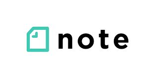
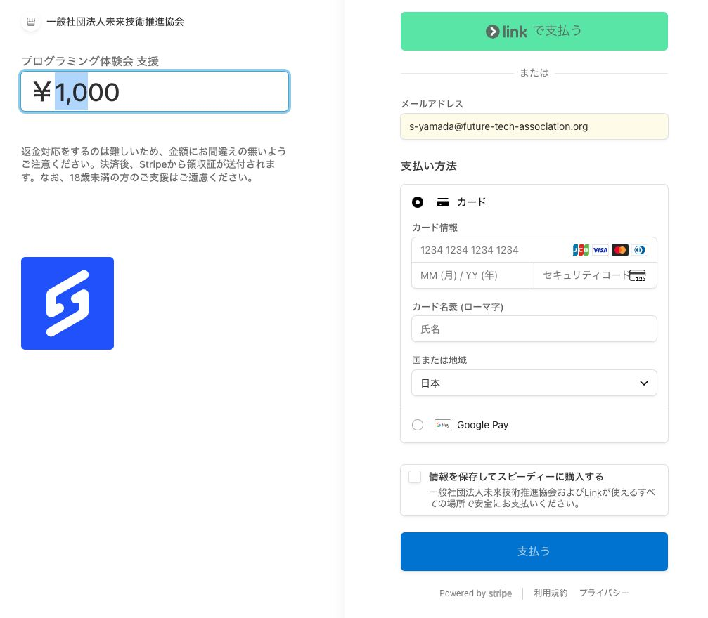
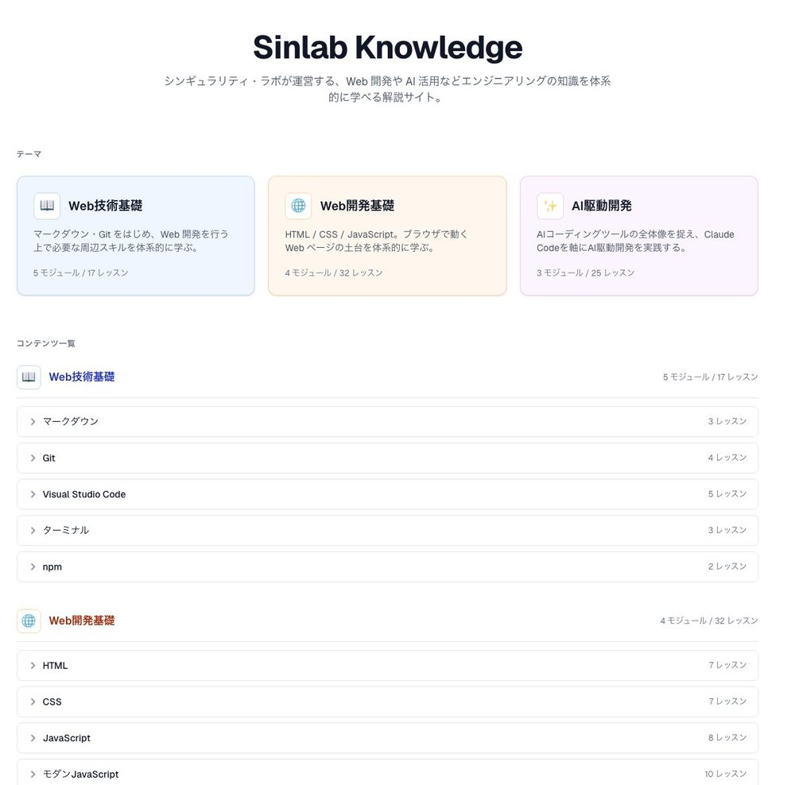
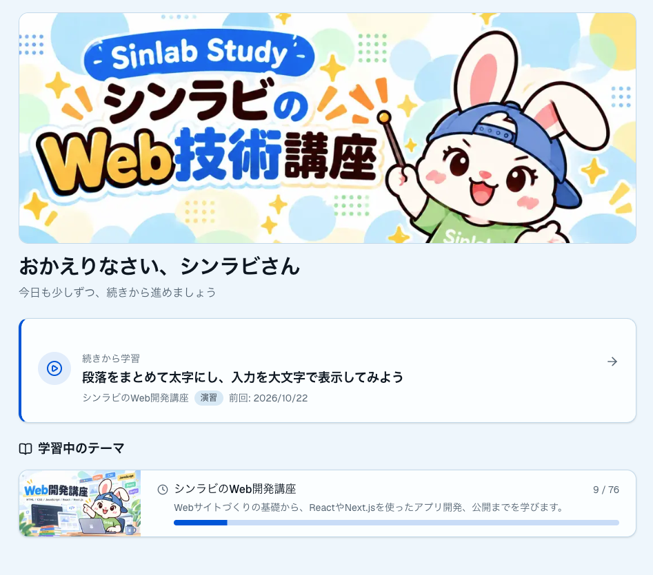
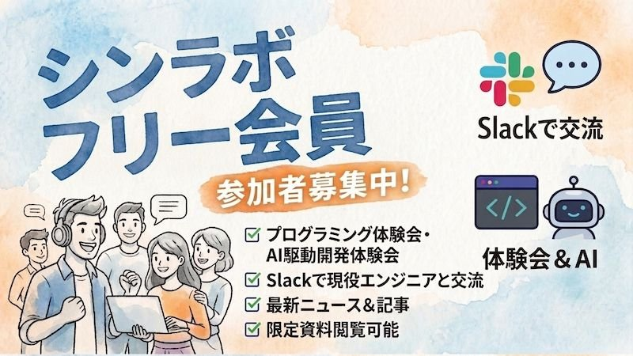

<!-- _paginate: skip -->
<!-- _footer: '' -->
<!-- _class: tk sns -->

## 過去体験会の情報は各種SNSでも公開中です

様々なSNSを通じてWeb技術のスキルアップに役立つ<br>情報を発信中！！

|  |  |  |
|:---:|:---:|:---:|
| イベント情報<br>スキルアップ情報 | Web/AI開発の<br>技術記事 | AI技術・GAS<br>動画配信 |

- Xアカウント：https://x.com/helloCodeSchool
- noteアカウント：https://note.com/hello_coding
- YouTubeアカウント：https://www.youtube.com/@エンジニアチャンネル

<!--
チャットや口頭でアカウントを案内するときの控え。
X：https://x.com/helloCodeSchool
note：https://note.com/hello_coding
YouTube：https://www.youtube.com/@エンジニアチャンネル
-->

---

<!-- _paginate: skip -->
<!-- _footer: '' -->
<!-- _class: tk lg -->

## イベント開始前のご案内

- 本体験会は録画いたしますのでご了承ください
- 講師からの問いかけには、了解(👍)や挙手(✋)などのスタンプで応答のご協力をお願いいたします
- 不明点や原因不明のエラーが出た場合、チャットでお気軽にご質問ください（エラー内容付きで）
- 本内容はnoteでも公開しているので、ぜひご活用ください。

<!--
開始直後に読む。録画の了承 → スタンプでの応答 → チャット質問（エラー内容付き）→ 公開先、の順。
-->

---

<!-- _paginate: skip -->
<!-- _footer: '' -->
<!-- _class: tk pair -->

## AI駆動開発 体験会のご支援のお願い

AI駆動開発 体験会を継続するために<br>ご支援をお願いいたします

- 金額は任意で設定可（500円以上）
- Stripeによる安全な決済
- 決済方法：クレジットカード・Google Pay・Apple Pay
- 入力頂いたメールアドレス宛に領収書を送付

<p class="fig">

決済用リンク
</p>

<!--
決済URL（チャット貼り付け用）：https://buy.stripe.com/6oUbJ1ePw5TMgh0eQe0Fi0c
任意・500円以上。クレジットカード / Google Pay / Apple Pay。領収書は入力メール宛。
-->

---

<!-- _class: lead tkt -->
<!-- _paginate: false -->
<!-- _footer: '' -->

# AI駆動開発 体験会

<p class="sub">Skills の利用</p>

<p class="org">シンギュラリティ・ラボ</p>

<!--
企画 Issue：https://github.com/Singuralitylabs/tech-share/issues/18
カリキュラム全体：https://github.com/Singuralitylabs/tech-share/issues/12（2026-11 回）
狙い：スキルとは何かを知り、自分のスキルを1つ作って動かすところまで体験する。
通しのメッセージ：毎回同じ説明をしている作業は、スキル（必要なときだけ読まれる手順書）にすれば、言わなくてよくなる。
対象：プログラミング・AI開発に関心のある初心者（20〜50人）。毎回新規参加者が多いので、前回までの知識を前提にしない。
前提：Claude Code のインストールと起動確認（claude --version）、Claude の有料プラン。未完了の方は見ているだけでOK。
解説環境：VS Code で SKILL.md を開き、同じ画面の統合ターミナルで claude を起動して見せる。ファイル構成と実行結果を同時に見せるため。
-->

---

<!-- _class: tkb -->
<!-- _header: 'OVERVIEW' -->

## 今日、AIに“手順書”を渡します

- **スキルとは何か**を知る
- **CLAUDE.md との使い分け**を知る
- **自分のスキルを1つ作って、動かす**
- **見るだけ参加でも大丈夫**です。手順はすべて資料に残します

> **手が止まったら、すぐチャットへ。進行より復帰を優先します**

<!--
今日のゴールは3つ。最後には自分専用のスキルが1つ手元に残る。
前回のおさらいは入れない（毎回新規参加者が多いため）。今日だけで完結する、と一言添える。
2分。
-->

---

<!-- _class: tkb center -->
<!-- _header: 'PART 01 · なぜスキルが要るのか' -->

## AIに、毎回同じ説明をしていませんか

> 議事録の形式、日報の書き方……**毎回、同じ説明を打っている**

- **CLAUDE.md**（起動時に毎回読み込まれる指示ファイル）に全部書くと、長くなるほどトークンを消費する
- 指示が多すぎると、守られにくくなる
- **必要なときだけ読ませたい** → そこで「スキル」

<!--
問いかけてスタンプで反応をもらう（「毎回同じ説明をしている」なら👍）。
Claude Code には CLAUDE.md という、起動時に毎回読み込まれる指示ファイルがある。ここに全部書けば解決しそうだが、長くなるとトークンを消費し、守られにくくなる。そこで登場するのがスキル。
CLAUDE.md はここで一言説明するだけ。初参加者を置いていかない。
3分。
-->

---

<!-- _class: tkb center -->
<!-- _header: 'PART 02 · スキルとは' -->

## スキルは、AIが必要なときだけ読む“手順書”

> 普段は**名前と説明だけ**。依頼に合ったときに、**中身を読む**

- **SKILL.md** というマークダウンファイルに書く
- 依頼内容に合うと、Claude が自動で読み込む
- 使うまで中身は読まれないので、たくさん用意しても重くならない

<!--
スキルは、AIが必要なときだけ読む手順書。普段は名前と説明だけが読まれ、依頼内容に合ったときに中身が読み込まれる。だから手順をたくさん用意しても重くならない。
公式ドキュメント：https://code.claude.com/docs/en/skills
1分半。
-->

---

<!-- _class: tkb ba -->
<!-- _header: 'PART 02 · スキルとは' -->

## いつも守ることは CLAUDE.md、作業の手順はスキル

| CLAUDE.md | スキル |
|---|---|
| 毎回必ず読まれる | 必要なときだけ読まれる |
| 全体の基本ルール | 特定の作業の手順 |
| 例：文体、やらないこと | 例：議事録の整形、日報づくり |
| 呼び出し不要（常に有効） | 自動、または `/スキル名` |

- 必ず守らせたい“決まり”は **settings.json** に書く

<!--
いつでも守ってほしいことは CLAUDE.md、特定の作業のときだけ必要な手順はスキル、と覚えてもらう。
settings.json は「仕組みで守らせる決まり」と名前だけ紹介（詳細は扱わない）。
1分半。
-->

---

<!-- _class: tkb dense -->
<!-- _header: 'PART 02 · スキルとは' -->

## SKILL.md は、2つの部分でできている

```
---
name: meeting-notes
description: 会議メモを決まった形式の議事録に整える
---

（ここに手順やルールを書く）
```

- **`name`**：スキルの名前（`/` で呼ぶときの名前）
- **`description`**：何をするか・いつ使うか（**自動で発動するかの決め手**）
- **本文**（`---` の下）：手順やルールを自由に書く

<!--
上の --- で囲まれた部分に名前と説明、その下に手順を書く。特に description が大事で、Claude はここを見て使うかどうかを判断する。
1分半。
-->

---

<!-- _class: tkb grid -->
<!-- _header: 'PART 02 · スキルとは' -->

## 置き場所は2つ。名前にはルールがある

- **個人用**
  - `~/.claude/skills/名前/SKILL.md`
  - 自分のPCの全プロジェクトで使える
- **プロジェクト用**
  - `.claude/skills/名前/SKILL.md`
  - そのフォルダだけ。Git でチームと共有できる
- **名前のルール**
  - フォルダ名がスキル名
  - ファイル名は必ず **`SKILL.md`**（大文字）

<!--
個人用とプロジェクト用の2か所に置ける。今日のワークはプロジェクト用（練習フォルダの中）に作る。
個人用スキルはクラウド（ブラウザ版）のセッションには届かない、と聞かれたら答える。
1分。
-->

---

<!-- _class: tkb grid -->
<!-- _header: 'PART 02 · スキルとは' -->

## 動かし方は2つ。一覧は /skills で見る

- **自動で発動**
  - 依頼が description に合うと、Claude が判断して使う
  - 例：「このメモを議事録にして」
- **手動で発動**
  - `/スキル名` を入力して呼び出す
  - 例：`/meeting-notes`
- **一覧を見る**
  - `/skills` で使えるスキルを確認

<!--
講師デモ：/skills で一覧を見せ、自動発動と /スキル名 の両方で動かす。自動で発動しないときは手動で呼べばよい。
カスタムスラッシュコマンド（.claude/commands/）はスキルに統合された。.claude/commands/deploy.md と .claude/skills/deploy/SKILL.md はどちらも /deploy になる、と聞かれたら答える（#12 の「カスタムコマンド」はここで回収）。
3分（デモ込み）。
-->

---

<!-- _class: tkb grid -->
<!-- _header: 'PART 03 · スキルの作り方' -->

## 作り方は、3つ。基本はAIに頼む

- **AIに依頼する**
  - **おすすめ・今日はこれ**
  - 「〇〇するスキルを作って」と頼むだけ
- **skill-creator**
  - **作り込むなら**
  - 公式の「スキルを作るスキル」
- **手で作る**
  - **細かい調整に**
  - テキストエディタで SKILL.md を書く

<!--
基本はAIに依頼するのが一番簡単。しっかり作り込みたいときは skill-creator、細かな修正は手動、と使い分ける。
今日のハンズオンは①で作る。
1分。
-->

---

<!-- _class: tkb grid -->
<!-- _header: 'PART 03 · スキルの作り方' -->

## skill-creator を使うと、何が嬉しい？

- **質問しながら整理してくれる**
  - いつ使うか・出力の形式・例外を聞いてから作る
- **書き方のコツが反映される**
  - 発動しやすい description など、公式の作法どおり
- **効果をテストできる**
  - スキルあり・なしの結果を比べて確かめる
- **改善を繰り返せる**
  - 感想を伝えて直す。自動で発動するよう調整する

<!--
AIに「スキルを作って」と頼むと一発で作ってくれるが、本当に効果があるか、ちゃんと自動で発動するかは分からない。
skill-creator は、まず質問で要件を整理し、公式の書き方のコツに沿って作り、テスト用の依頼文でスキルあり・なしの結果を比べ、発動のしやすさ（description）まで調整してくれる。
使い分け：手早く作るならAIに依頼、しっかり作り込むなら skill-creator。業務で繰り返し使うスキルは skill-creator で作り込むのがおすすめ。
出典：https://github.com/anthropics/skills（skills/skill-creator/SKILL.md）
3分。
-->

---

<!-- _class: tkb dense -->
<!-- _header: 'PART 03 · スキルの作り方' -->

## skill-creator は、プラグインで入れる

**① Anthropic 公式のスキル集を登録する**

```
/plugin marketplace add anthropics/skills
```

**② skill-creator を含むプラグインを入れる**

```
/plugin install example-skills@anthropic-agent-skills
```

**③ 頼む**

```
skill-creatorで、会議メモを議事録に整えるスキルを作りたい
```

<!--
skill-creator は Anthropic が公開しているスキル集（anthropics/skills）の example-skills プラグインに入っている。
example-skills には skill-creator 以外のサンプルスキルも入っているので、中身を見るとスキルの書き方の参考になる。
ここは見せるだけ。ハンズオンの最後に余裕がある人が試す。
2分。
-->

---

<!-- _class: tkb dense -->
<!-- _header: 'PART 04 · ハンズオン / STEP 1-2' -->

## STEP 1-2｜スキルなしで、議事録を頼む

**① 練習用フォルダ `skills-practice` を作り、そこで起動する**

```
claude
```

**② 下のメモと依頼文を、そのまま貼って送る**

```
このメモを議事録にして。
11/2 定例。参加は田中、佐藤。来月の体験会はGASでいく。資料は佐藤が金曜までに作る。次回は集客方法を話す。
```

**出てきた議事録の形を、覚えておきましょう**（見出し・項目・TODO の書き方）

<!--
依頼文とメモはチャットにも貼る。全員が同じ文を使うことが、後の比較の前提。
フォルダの作り方とターミナルの開き方：Windows はフォルダを開いてアドレスバーに powershell と入力 → Enter。Mac はターミナルで「cd 」と打ってフォルダをドラッグ&ドロップ → Enter。
講師は自分の画面で実行して、スキルなしの出力を見せる。
許可を聞かれたら y / Enter。
5分。
-->

---

<!-- _class: tkb dense -->
<!-- _header: 'PART 04 · ハンズオン / STEP 3' -->

## STEP 3｜Claude Code に、スキルを作ってもらう

**次の依頼文を、そのまま送る**

```
会議メモを議事録に整えるスキルを、このフォルダの .claude/skills に作って。
形式は、日時・参加者／決定事項／TODO（担当者と期限）／次回の議題。
メモにない情報は「未定」と書くこと。
```

- ファイル作成の許可を聞かれたら、**許可**する
- できたら **`.claude/skills/`** の中の **`SKILL.md`** を開いて、中身を見る
- **`name`**・**`description`**・手順が、どう書かれたか確認する

<!--
講座の主役。時間が押しても削らない。
作られた SKILL.md を必ず開いて、name、description、手順がどう書かれたかを見てもらう。人によって中身は少しずつ違ってよい。
VS Code の画面で、左のファイル一覧に .claude/skills/<名前>/SKILL.md ができる様子を見せる。
7分（次のスライドと合わせて）。
-->

---

<!-- _class: tkb dense long -->
<!-- _header: 'PART 04 · ハンズオン / STEP 3' -->

## できあがる SKILL.md の例

```
---
name: meeting-notes
description: 会議のメモを決まった形式の議事録に整える。議事録・会議メモの整理を頼まれたときに使う。
---

渡されたメモを、次の形式の議事録にしてください。
# 形式
- 日時・参加者
- 決定事項（箇条書き）
- TODO（担当者と期限つき）
- 次回の議題
# ルール
- メモにない情報は補わず「未定」と書く
- です・ます調で、各項目は1行以内
```

<!--
AIに作ってもらうと、だいたいこのような形になる。description に「何をするか」と「どんなときに使うか」の両方が書かれているかを確認する。
うまく作れなかった人は、この例を .claude/skills/meeting-notes/SKILL.md に手で貼り付けて保存する（救済策）。同じテキストをチャットにも貼る。
-->

---

<!-- _class: tkb dense -->
<!-- _header: 'PART 04 · ハンズオン / STEP 4' -->

## STEP 4｜同じ依頼を、もう一度送る

**① いったん終了して、もう一度起動する**

```
/exit
claude
```

**② 新しいセッションで、STEP 2 と同じメモと依頼文を送り、形が変わったか比べる**

**③ 手動でも呼んでみる**：`/meeting-notes` と入力して送る

> **スキル名が違うときは、`/skills` で一覧を見て、その名前で呼ぶ**

**余裕がある人へ**：skill-creator で、このスキルを改善してみる

<!--
同じ依頼文でも、スキルの有無で議事録の形式が変わる。これが今日の「覚えて帰る1つ」。
うまくいった方は👍、動かない方はチャットでエラー内容と一緒に。
SKILL.md の書き換えはその場で反映されるので、形式を自分好みに変えて試してもよい。
新しく skills フォルダができた場合は /reload-skills で読み込み直す。
5分。
-->

---

<!-- _class: tkb grid -->
<!-- _header: 'PART 04 · ハンズオン' -->

## 止まっていたら、ここを見てください

- **一覧に出てこない**
  - `/skills` で確認。新しく作ったなら `/reload-skills`
- **設定が読まれない**
  - `---` が **1行目** にあるか
- **自動で発動しない**
  - description に「何を・いつ」を両方書く
- **ファイル名が違う**
  - `skill.md` ではなく **`SKILL.md`**（大文字）

<!--
巡回のチェック順：(1) ファイル名と置き場所 (2) 1行目の --- (3) description。
項目名のタイプミス（descripton など）はエラーにならず黙って無視されるので気づきにくい。
追いつかない人は、例の SKILL.md を貼るだけで十分。比較は一緒に見られる。
3分。
-->

---

<!-- _class: tkb grid -->
<!-- _header: 'PART 05 · 応用' -->

## スキルには、ファイルやスクリプトも同梱できる

- **`csv-summary/` フォルダに置けるもの**
  - `SKILL.md`（スキル本体）
  - `template.md`（出力の雛形）
  - `scripts/summarize.py`（集計用のスクリプト）
- **できること**
  - テンプレートや参考資料を一緒に置ける
  - Python スクリプトを実行させて、集計を自動化
  - 「売上CSVを集計して」で、毎回同じ手順・同じ形式に

<!--
スキルはフォルダなので、SKILL.md の横にテンプレートやスクリプトを置ける。SKILL.md からそれらを参照すると、Claude が必要なときに読んだり実行したりする。
GAS のコードの書き方ルールもスキルにできる。業務効率化講座の Python や GAS と組み合わせると強力。
2分。
-->

---

<!-- _class: tkb -->
<!-- _header: 'CLOSING' -->

## 毎回同じ説明をしている作業を、スキルにしよう

- 基本ルールは **CLAUDE.md**（毎回読まれる）
- 特定の作業の手順は **スキル**（必要なときだけ読まれる）
- 必ず守らせたい決まりは **settings.json**
- スキルは **AIに頼んで作る** のが簡単（作り込むなら skill-creator）

> **作ったスキルは、シンラボの Slack で見せ合いましょう**

<!--
今日作った議事録スキルをきっかけに、日報やメール文面など、毎回同じ説明をしている作業をスキルにしてみてほしい。
フリー会員（無料）の Slack で作ったスキルを共有できる、とこの後のシンラボ紹介につなげる。
3分。
-->

---

<!-- _paginate: skip -->
<!-- _footer: '' -->
<!-- _class: tk lg -->

## AI駆動開発体験会アンケート

チャットにもURLを貼りますので、ご回答お願いします<br>（アンケート回答頂いた方には本スライドをお送りします）


<!--
アンケートURL（チャット貼り付け用）：
https://docs.google.com/forms/d/e/1FAIpQLSfJlSsAqvXaS6id-DIRjz9EIsMUYUnYBdpsrXkd1kOEt1i9-Q/viewform?usp=header
回答者に本スライドを送る旨を口頭でも添える。
-->

---

<!-- _paginate: skip -->
<!-- _footer: '' -->
<!-- _class: tk pair -->

## AI駆動開発体験会のご支援のお願い

本AI駆動開発 体験会を継続するため、<br>ご支援をお願いいたします。

- 金額は任意で設定可（500円以上）
- Stripeによる安全な決済
- 決済方法：クレジットカード・Google Pay・Apple Pay
- 入力頂いたメールアドレス宛に領収書を送付

<p class="fig">

決済用リンク
</p>

<!--
決済URL（チャット貼り付け用）：https://buy.stripe.com/6oUbJ1ePw5TMgh0eQe0Fi0c
opening 3枚目とほぼ同内容。導入文だけ「本〜継続するため、」になっている。
-->

---

<!-- _paginate: skip -->
<!-- _footer: '' -->
<!-- _class: tk pair -->

## AI駆動開発体験会のご支援のお願い



<p class="fig">

決済用リンク
</p>

<!--
決済画面のスクショ（メールアドレスは公開済みのためマスキングしない）＋同じ決済QR。
決済URL：https://buy.stripe.com/6oUbJ1ePw5TMgh0eQe0Fi0c
-->

---

<!-- _paginate: skip -->
<!-- _footer: '' -->
<!-- _class: tk pair lg -->

## 今後のイベントのお知らせ

**Web技術・AI駆動開発体験会**

- 11/9 (月) 20時~ 業務効率化講座 Excel集計
- 11/16 (月) 20時~ チーム開発体験会
- 12/7 (月) 20時~ AI駆動開発講座 MCPの活用
- 12/14 (月) 20時~ Pythonによる業務効率化講座

<p class="fig">

申込フォーム
</p>

<!--
差し替え欄：小見出し（シリーズ名）と開催日程。転記時に最新の3〜4件へ更新する。箇条書きの「日付 (曜) 時刻~ 講座名 テーマ」の型は残す。
申込URL（チャット貼り付け用）：https://forms.gle/rq9TDREWNbZwoEAW6
-->

---

<!-- _paginate: skip -->
<!-- _footer: '' -->
<!-- _class: tk msg -->

## シンギュラリティ・ラボとは

テクノロジーによる<br>社会課題解決を目指すコミュニティ


<!--
コミュニティの一言紹介。写真は集合カット（Singularity Lab の看板）。短く置いて次の「どんなコミュニティなの？」へ渡す。
-->

---

<!-- _paginate: skip -->
<!-- _footer: '' -->
<!-- _class: tk pair lg -->

## どんなコミュニティなの？

会員数は約50名で、技術職・文系職・学生等、多くの職種の方が参加

活動目的やペースは各自の自由<br>（アプリ開発、不定期の情報収集など）

オンライン以外に、ワーケーションや飲み会等のオフライン企画あり

<p class="fig">

オンライン交流会

お花見の様子
</p>

<!--
多様性・各自のペース・オフライン企画の3点。写真はオンライン交流会とお花見。
-->

---

<!-- _paginate: skip -->
<!-- _footer: '' -->
<!-- _class: tk pair wide -->

## シンラボ活動のご紹介「スキルアップ講座」

月に数回、AI開発スキルや<br>基礎的なWeb技術講座（マークダウン等）<br>を開催。

※アーカイブ動画や講座内で使った<br>記事サイトはいつでも閲覧可能

<p class="fig">

</p>

<!--
講座の頻度と内容、アーカイブ・記事サイトがいつでも見られる点。画像は講座で使っている記事サイト（Sinlab Knowledge）。
-->

---

<!-- _paginate: skip -->
<!-- _footer: '' -->
<!-- _class: tk pair wide -->

## シンラボ活動のご紹介「Sinlab Study」

**自分のペースで学習する** Web学習支援サービス（一部無料公開中）

**主な機能**

- 動画・スライドでの学習
- 課題提出による実践力強化
- 提出課題のAIレビュー

|  |  |
|:---:|:---:|
| サービスサイト | 紹介サイト |

<p class="fig">

トップ画面
</p>

<!--
サービスサイト：https://study.future-tech-association.org/
紹介サイト：https://sinlab.future-tech-association.org/sinlab-study/
QRの取り違えに注意（左＝サービスサイト / 右＝紹介サイト。元資料の配置）。
-->

---

<!-- _paginate: skip -->
<!-- _footer: '' -->
<!-- _class: tk pair wide -->

## シンラボ活動のご紹介「チーム開発体験」

オンラインで集まって、<br>コミュニティ内で使うアプリを開発

個人では体験できないチーム<br>ならではの開発フローや知見を<br>学べる

見学のみも可

<p class="fig">

</p>

<!--
オンラインでのチーム開発。個人開発では得にくいフロー・知見が学べること、見学だけでも参加できることを添える。
-->

---

<!-- _paginate: skip -->
<!-- _footer: '' -->
<!-- _class: tk big -->

## 10月の主なシンラボ活動の紹介

- AI駆動開発の解説（プロジェクト機能の紹介）
- Web技術解説講座（Jsonの解説）
- Webアプリのチーム開発
- AIを使ったアプリ開発会
- もくもく会

<!--
差し替え欄：見出しの月と箇条書きの中身を、転記時に直近月の活動へ更新する。箇条書き4項目の型は残す。
-->

---

<!-- _paginate: skip -->
<!-- _footer: '' -->
<!-- _class: tk big -->

## 会費は？

- 入会費　：無料
- 一般会員：3,000円／月（税込、前払い）
- 学生会員：1,500円／月　※高校生、高専生は無料
- 支払い方法
  - クレジットカード決済のみ
  - 毎月27日に次月分を自動決済

<!--
学生は高校生・高専生が無料である点を口頭で補う。
-->

---

<!-- _paginate: skip -->
<!-- _footer: '' -->
<!-- _class: tk big -->

## 注意すること

- 誹謗中傷や勧誘活動などの、人の嫌がる行為は禁止
- 会員の個人情報の収集や無断での外部への開示は禁止
- 入会時の申告内容に虚偽があったり、会費を2ヶ月滞納した場合は退会となるので注意

<!--
禁止事項は3点だけ。責めずに「これだけ守れば大丈夫」のトーンで読む。
-->

---

<!-- _paginate: skip -->
<!-- _footer: '' -->
<!-- _class: tk pair -->

## フリー会員のご案内

いきなり会員になるのはハードルが高い...<br>という方に向けて“**シンラボ フリー会員**”の募集を開始しました



<p class="fig">
申し込みは<br>専用フォームから！

</p>

<!--
有料会員の前段として無料のフリー会員を案内する（Slack交流・体験会・限定資料閲覧）。
申込フォーム：https://docs.google.com/forms/d/e/1FAIpQLSeW5Trd4st5TU_zMzKZeZbFE0t0B6YGxNpJ0veAnhCkhE94eA/viewform
-->

---

<!-- _paginate: skip -->
<!-- _footer: '' -->
<!-- _class: tk msg -->

## 最後に

シンラボの仲間と一緒に、<br>スキルを高めて新しい価値を<br>創り出していきましょう！

<!--
クロージング。余韻を残して終える。
-->

---

<!-- _paginate: skip -->
<!-- _footer: '' -->
<!-- _class: split tk -->

<!--
区切りの空白スライド（右に青グラデのパネルだけ）。前回資料どおり「最後に」と付録の間に置く。
-->

---

<!-- _paginate: skip -->
<!-- _footer: '' -->
<!-- _class: tk pair wide -->

## シンラボ活動のご紹介「Sinlab Knowledge」

Web技術の重要な知識をまとめたサイト（会員のみアクセス可）

**主な内容**

- マークダウン・Git操作
- HTML/CSS/JavaScriptの基礎
- React等のWeb開発言語の基礎
- AI駆動開発のノウハウ

|  |
|:---:|
| サービスサイト |

<p class="fig">

https://knowledge.future-tech-association.org/
</p>

<!--
付録。質問が出たとき・時間が余ったときに見せる会員限定の学習サイト。
URL：https://knowledge.future-tech-association.org/
-->
