<!-- _paginate: skip -->
<!-- _footer: '' -->
<!-- _class: tk sns -->

## 過去体験会の情報は各種SNSでも公開中です

様々なSNSを通じてWeb技術のスキルアップに役立つ<br>情報を発信中！！

|  | 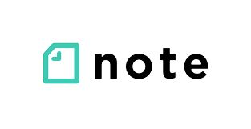 |  |
|:---:|:---:|:---:|
| イベント情報<br>スキルアップ情報 | Web/AI開発の<br>技術記事 | AI技術・GAS<br>動画配信 |

- Xアカウント：https://x.com/helloCodeSchool
- noteアカウント：https://note.com/hello_coding
- YouTubeアカウント：https://www.youtube.com/@エンジニアチャンネル

<!--
チャットや口頭でアカウントを案内するときの控え。
X：https://x.com/helloCodeSchool
note：https://note.com/hello_coding
YouTube：https://www.youtube.com/@エンジニアチャンネル
-->

---

<!-- _paginate: skip -->
<!-- _footer: '' -->
<!-- _class: tk lg -->

## イベント開始前のご案内

- 本体験会は録画いたしますのでご了承ください
- 講師からの問いかけには、了解(👍)や挙手(✋)などのスタンプで応答のご協力をお願いいたします
- 不明点や原因不明のエラーが出た場合、チャットでお気軽にご質問ください（エラー内容付きで）
- 本内容はnoteでも公開しているので、ぜひご活用ください。

<!--
開始直後に読む。録画の了承 → スタンプでの応答 → チャット質問（エラー内容付き）→ 公開先、の順。
-->

---

<!-- _paginate: skip -->
<!-- _footer: '' -->
<!-- _class: tk pair -->

## AI駆動開発 体験会のご支援のお願い

AI駆動開発 体験会を継続するために<br>ご支援をお願いいたします

- 金額は任意で設定可（500円以上）
- Stripeによる安全な決済
- 決済方法：クレジットカード・Google Pay・Apple Pay
- 入力頂いたメールアドレス宛に領収書を送付

<p class="fig">

決済用リンク
</p>

<!--
決済URL（チャット貼り付け用）：https://buy.stripe.com/6oUbJ1ePw5TMgh0eQe0Fi0c
任意・500円以上。クレジットカード / Google Pay / Apple Pay。領収書は入力メール宛。
-->

---

<!-- _class: lead tkt -->
<!-- _paginate: false -->
<!-- _footer: '' -->

# AI駆動開発 体験会

<p class="sub">MCP で AI に道具をつなぐ</p>

<p class="org">シンギュラリティ・ラボ</p>

<!--
企画 Issue：https://github.com/Singuralitylabs/tech-share/issues/25
カリキュラム全体：https://github.com/Singuralitylabs/tech-share/issues/12（MCP は 2027-04「外部サービスとつなぐ：MCP」の枠を前倒し）
狙い：MCP とは何かを知り、Claude Code に MCP サーバーを1つつないで、AIにできることが増えるのを自分の目で確かめる。
通しのメッセージ：AIは「頭」はいいが、手が届く範囲は限られている。MCP で道具をつなぐと、AIにできることが広がる。
整理の軸：CLAUDE.md＝いつも守ること（ルール）／スキル＝作業の手順／MCP＝外の世界とつなぐ道具。CLAUDE.md・スキルは一言で触れるだけにする。
作り方の軸：つなぐのは基本「公式の1行コマンドをコピペ」か「AIに『〇〇の MCP を追加して』と頼む」。claude.ai のコネクタは画面から追加できる。設定ファイル（.mcp.json）を手で書く方法は補足。
覚えて帰る1つ：同じ依頼でも、MCP が無いと「できません」、つなぐとブラウザが開いてAIが操作する。
対象：プログラミング・AI開発に関心のある初心者（20〜50人）。毎回新規参加者が多いので、前回までの知識を前提にしない。
前提：Claude Code のインストールと起動確認（claude --version）、Claude の有料プラン。コース A は Node.js 18 以上（node --version）。入っていない方はインストール不要のコース B（DeepWiki MCP）で参加できる。未完了の方は見ているだけでOK。
解説環境：VS Code の統合ターミナルで claude を起動して見せる。コマンドの入力と、Claude が MCP の道具を呼ぶ様子・開いたブラウザを同じ画面で見せるため。claude.ai のコネクタは画面の紹介だけにする。
講師が用意するもの：デモ用の練習ページ（https://example.com）と Before / After の結果のスクリーンショット控え（当日つながらなかったとき用）、チャット貼り付け用の依頼文・コマンド一式。講師のマシンで Playwright MCP・DeepWiki MCP を一度追加して動作確認しておく（初回は npx のダウンロードに時間がかかる）。
配布物：ハンズオン用テキスト（STEP 2〜4 の依頼文と、コース A・B の追加コマンド）、練習用ページの URL と聞いてみる質問の例、救済用の手順メモ（claude mcp list → /mcp の見方、claude mcp remove でやり直す方法）。
要確認：配布方法（11/2 回と同じく当日 Zoom のチャットでファイル共有にするか）。
要確認：カリキュラム #12 の表（12月＝基本操作、MCP＝2027-04）を、12/7 を MCP にする形に更新する。
時間が押したら：応用スライドを口頭1分に／スコープ（保存先）の説明は「既定のままでよい」の一言にして資料に残す。
紹介しないもの：MCP サーバーの自作、.mcp.json の手書き、OAuth の細かい設定、リソース（@）やプロンプトなどツール以外の機能、API キーが要るサーバー。
-->

---

<!-- _footer: '' -->
<!-- _class: tk prof -->

## 講師紹介


### 山田　慎也

- 出身：広島
- 職業：ITエンジニア<br>未来技術推進協会 理事<br>Hello Coding School講師
- 略歴：

大阪大学卒業後、大手メーカーの研究所に勤務後、エンジニアとして独立。2017年に仲間と共に未来技術推進協会を設立。

<!--
講師の自己紹介（1分）。出身・職業・略歴を読み上げ、今日の体験会で担当すること（進行・デモ）を一言添える。
-->

---

<!-- _class: tkb center -->
<!-- _header: 'OVERVIEW' -->

## 今日、AIに“道具”をつなぎます

> 最後には、**AIがブラウザを操作する様子**を自分の画面で見る

- **MCP とは何か**を知る
- **Claude Code に MCP をつなぐ方法**を知る
- **自分の手で1つつないで、動かす**
- 見るだけでもOK。Node.js が無い方は **コース B** で参加できます

<!--
ゴールは3つ：MCP とは何かを知る／Claude Code に MCP をつなぐ方法を知る／自分の手で1つつないで動かす。
最後には、AIがブラウザを操作する様子を自分の画面で見られる、と予告する。
環境がない方は見ているだけでOK。Node.js が無い方はコース B（DeepWiki MCP。インストール不要）で参加できる。
手が止まったら、すぐチャットへ。進行より復帰を優先する、と添える。
前回のおさらいは入れない（毎回新規参加者が多いため）。今日だけで完結する、と一言添える。
2分。
-->

---

<!-- _class: tkb -->
<!-- _header: 'PART 01 · なぜ MCP が要るのか' -->

## AIの手が届かない作業、ありませんか

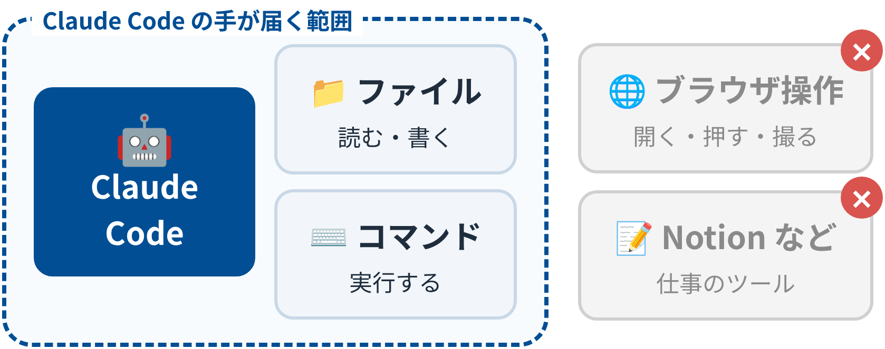

> **だから、AIに「道具」を持たせたい → MCP**

<!--
問いかけ：「この Web ページを開いて、ボタンを押して、画面を撮って」「Notion のメモを読んで」と頼んだらどうなるか（スタンプで反応をもらう）。
Claude Code（ターミナルで動く AI。ファイルの読み書きとコマンド実行ができる）は手元のフォルダの中なら強いが、ブラウザ操作や社内ツールには手が届かない。だから「AIに道具を持たせたい」→ MCP。
講師デモ：MCP なしで「example.com をブラウザで開いてスクリーンショットを撮って」と頼み、できない（またはページの文字を読むだけ）ことを見せる。
注意：Claude Code は Web ページの文字を取ってくる機能（WebFetch）は持っているので、「ページを読む」だけの依頼だと MCP なしでもこなせてしまう。Before の依頼は「ブラウザで開いて操作する・画面を撮る」にする。
要確認：Claude Code が WebFetch などでタイトルだけ答えてしまう場合の見せ方（リハーサルで確かめる。「タイトルは読めたが、ブラウザは開いていない・スクリーンショットは撮れていない」と指摘する）。
4分（デモ込み）。
-->

---

<!-- _class: tkb center -->
<!-- _header: 'PART 02 · MCP とは / 動画' -->

## 動画で見る：MCP とは、なぜ必要か

> **Sinlab Study の動画より**：AI駆動開発講座 第8回「MCPの活用」（0:42〜3:48、約3分）

- AIにコピー＆貼り付けで渡す「運び屋」をやめられる
- つなぎ方をそろえると、**1回作れば多くの AI ツールで使える**
- 登場人物は2つ：**使う側**（Claude Code）と**提供する側**（サーバー）

<!--
動画パート（試行）：Sinlab Study の解説動画を1本はさんで、講師の解説の負担を減らし、Sinlab Study を知ってもらう（yamada 了承、2026-11-23。結果を見て企画 Issue テンプレートに枠を足すか決める）。
動画：Sinlab Study「シンラビのAI駆動開発講座」第8回「MCPの活用」の解説動画（全体約22分）。流すのはチャプター「MCP とは、なぜ必要か」（0:42）〜「しくみ：クライアントとサーバー」の終わり（3:48）の約3分。続く「MCP の 3 つの機能」（3:48〜）からは今日扱わない内容（リソース・プロンプト）なので、3:48 で止める。
動画の要点（Sinlab Study の原稿より）：
- MCP は Model Context Protocol の略で、AIと外部のサービスやツールをつなぐ共通の決まりごと（プロトコル＝通信の約束事。Web の HTTP もプロトコルの1つ）。
- AI はそのままだと手元のファイルと自分の知識の範囲でしか仕事ができない。別のサービスの画面からコピーして AI に貼ると、人間が毎回「運び屋」になる。MCP でつなげば AI が直接読んだり操作したりできる。
- つなぎ方がバラバラだと組み合わせの数だけ作り直しになる。共通の約束があれば、サービス側は1回作れば MCP に対応したいろいろな AI ツールから使える。
- できること：課題の内容を読んで実装する、監視データでエラーの傾向を調べる、データベースに自然な言葉で質問する、ブラウザを操作して画面の動作を確認する。
- しくみ：MCP クライアント（AIを使う側。Claude Code）が、MCP サーバー（外部の機能を提供する側）に「どんなことができますか」と聞き、一覧から必要な道具を使う。サーバーにはインターネット上の URL でつなぐもの（リモート）と、自分のパソコンで動かすもの（ローカル）がある。
進め方：
- 再生前（1文）：「MCP とは何かを、Sinlab Study の動画で3分だけ見てみます。キャラクター（シンラビ）が話す動画です。『運び屋』という言葉に注目してください」
- 再生：講師の PC から Zoom の画面共有で「音声を共有」をオンにして、0:42 から流し、3:48 で止める。
- 再生後（1分）：「人が運び屋にならなくていい」「1回作れば多くの AI で使える」の2点を言い直し（動画の『クライアント』＝AIアプリ、『リモート』＝ネットの向こう、『ローカル』＝手元）、次の2枚（差し込み口の図・登場人物の図）は動画のおさらいとして各30秒で流す。
- 流れなかったら：次の予備スライドを口頭で説明して進む（流れたら予備スライドは飛ばす）。
時間配分：動画パート（前後込みで約5分）は PART 02「MCP とは」（8分）の中で、次の2枚の説明を短くして吸収する（次の2枚は各30秒、「つなぐと、こんなことができる」は1分）。PART 02 は約9分。1分は応用スライドを口頭1分にして吸収。
要確認：
- 動画が Sinlab Study に掲載済みか（2026-11-23 時点で原稿は「未掲載」）。12/7 までに掲載されない場合の再生方法。
- 動画ページの URL（末尾の Sinlab Study 紹介スライドで案内する）。
- 講座名・回の表記（サイト上の正式名。原稿リポジトリのテーマ名は『AI駆動開発の基礎』）にそろえる。
- 12/7 までに未掲載なら、まとめの『今日の動画の続きは Sinlab Study で』の行は消す。
- 事前リハーサルで音声・画質と、0:42・3:48 の位置を確認する。
-->

---

<!-- _class: tkb -->
<!-- _header: 'PART 02 · MCP とは / 動画が流れないとき' -->

## 予備｜AIは、外の世界の情報に手が届かない

- AIは、手元のファイルと自分の知識の範囲でしか仕事ができない
- 別の画面からコピーして貼ると、**人が毎回「運び屋」になる**
- MCP でつなぐと、AIが**直接読んだり操作したり**できる
- 共通の約束なので、**1回作れば多くの AI ツールで使える**

<!--
予備スライド：動画が再生できなかったときだけ使う（再生できたら飛ばす）。内容は動画（AI駆動開発講座 第8回「MCPの活用」0:42〜3:48）の要点。
プロトコル＝通信の約束事。Web のページを見るときの HTTP もプロトコルの1つ、と添える。
1分。
-->

---

<!-- _class: tkb center -->
<!-- _header: 'PART 02 · MCP とは' -->

## MCPは、AIに道具をつなぐ共通の差し込み口

> **MCP**（Model Context Protocol）＝ AIと外部の道具をつなぐ**共通の規格**

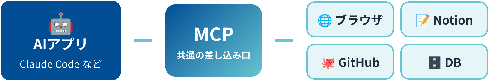

- よく「**AI の USB-C**」と例えられる。一度対応すれば、ほかの AI アプリからも使える

<!--
MCP（Model Context Protocol）＝AIと外部の道具をつなぐ共通の規格。「AI の USB-C」とよく例えられる。一度対応すれば、Claude Code 以外の AI アプリからも同じ道具が使える。
「ツール」「サーバー」という言葉は初心者に重いので、スライドでは「道具」「道具を提供する側」と言い換え、正式名称はカッコで添える。
公式ドキュメント：https://code.claude.com/docs/en/mcp
MCP の仕様：https://modelcontextprotocol.io/
30秒（動画のおさらい）。
-->

---

<!-- _class: tkb -->
<!-- _header: 'PART 02 · MCP とは' -->

## 登場人物は2つ。AIアプリと、道具を提供する側

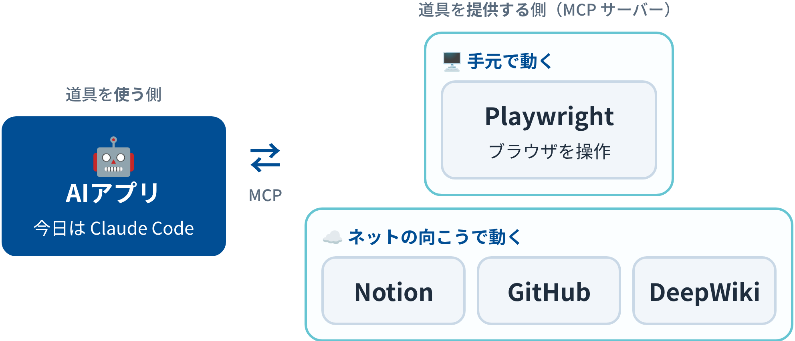

<!--
登場人物は2つ：AIアプリ（Claude Code）と MCP サーバー（道具を提供する側）。
MCP サーバーには、手元で動くもの（例：Playwright＝ブラウザ操作）とネットの向こうで動くもの（例：Notion、GitHub）がある。
今日のハンズオンでは、コース A で手元で動く Playwright、コース B でネットの向こうで動く DeepWiki をつなぐ。
30秒（動画のおさらい）。
-->

---

<!-- _class: tkb grid -->
<!-- _header: 'PART 02 · MCP とは' -->

## つなぐと、こんなことができる

- **ブラウザを操作する**
  - ページを開く・押す・画面を撮る
- **仕事のツールを読み書き**
  - Notion や GitHub の中身を扱う
- **データベースを調べる**
  - 中のデータを AI に調べてもらう
- **ドキュメントを調べる**
  - 公開リポジトリの解説などを引く

<!--
つなぐと何ができるか：ブラウザを操作する／Notion や GitHub を読み書きする／データベースを調べる／ドキュメントを調べる。
今日はこのうち「ブラウザを操作する」（コース A：Playwright）と「ドキュメントを調べる」（コース B：DeepWiki）を体験する。
1分（動画で見た内容なので短く）。
-->

---

<!-- _class: tkb dense -->
<!-- _header: 'PART 02 · MCP とは' -->

## つないだ道具は、2つの方法で確かめる

**① ターミナルで、つないだ一覧を見る**

```
claude mcp list
```

**② Claude Code の中で、状態とログインを見る**

```
/mcp
```

- AIが道具を使うときは、**許可を求めてくる**

<!--
確かめ方：claude mcp list でつないだ一覧、Claude Code の中で /mcp で状態とログイン。AIが道具を使うときは許可を求めてくる。
講師デモ：講師の環境で /mcp を開き、つながっている MCP サーバーの一覧と状態を見せる。
claude mcp list はターミナル（Claude Code の外）で打つ、/mcp は Claude Code の中で打つ、という違いを強調する。
要確認：/mcp の画面のスクリーンショットを載せるか（講師デモで代替するなら不要）。
2分（デモ込み）。
-->

---

<!-- _class: tkb grid -->
<!-- _header: 'PART 03 · つなぎ方と安全な使い方' -->

## つなぎ方は、基本コピペ1行

- **① 公式の1行コマンド**
  - **おすすめ・今日はこれ**
  - `claude mcp add ...` をコピペ
- **② AIに頼む**
  - 「Playwright の MCP を追加して」
- **③ claude.ai のコネクタ**
  - 画面から追加するだけ
  - Claude Code でも使える
- **保存先は既定のままでOK**
  - このフォルダだけ・自分だけ

<!--
つなぎ方は3つ：①公式の1行コマンドをコピペ（claude mcp add ...。おすすめ）②AIに「Playwright の MCP を追加して」と頼む ③claude.ai のコネクタ画面から追加（claude.ai でログインしていれば Claude Code でも使える）。
コマンドの形：claude mcp add --transport http <名前> <URL>（ネットの向こう）／claude mcp add <名前> -- <起動コマンド>（手元。-- より後ろはサーバーの起動コマンド）。
保存先（スコープ）は3つ：このフォルダだけ・自分だけ（既定）／このフォルダをチームで共有（.mcp.json）／自分のすべてのフォルダ（--scope user）。今日は既定のままでよい。
スコープの保存先：local と user は ~/.claude.json、project は .mcp.json（公式ドキュメントの Scopes 節）。
時間が押したら、スコープは「既定のままでよい」の一言にする。
オプションが無いときは -- を省ける（STEP 3 のコマンドはこの形）。
要確認：②「AIに追加を頼む」流れ（Claude Code が claude mcp add を実行 → 使えるようになるまでに再起動が要るか）をリハーサルで確かめる。
3分。
-->

---

<!-- _class: tkb -->
<!-- _header: 'PART 03 · つなぎ方と安全な使い方' -->

## 安全に使う、3つの約束

- **信頼できる提供元のものだけ**つなぐ
  （外のページを読む道具は、ページに仕込まれた指示に引っぱられることがある）
- **API キーなどの合言葉**は、チャットや共有ファイルに貼らない
- **許可を求められたら**、何をしようとしているか読んでから許可する

<!--
安全に使う：信頼できる提供元のものだけつなぐ（外のページを読む道具は、ページに仕込まれた指示に引っぱられることがある）／API キーなどの合言葉はチャットや共有ファイルに貼らない／許可を求められたら何をしようとしているか読んでから許可する。
公式ドキュメントの注意書き：信頼できるサーバーだけつなぐこと。外部コンテンツを取ってくるサーバーはプロンプトインジェクション（ページに仕込まれた指示に AI が従ってしまうこと）のリスクがある。
3分。
-->

---

<!-- _class: tkb dense -->
<!-- _header: 'PART 04 · ハンズオン / STEP 1-2' -->

## STEP 1-2｜まずは道具なしで、頼んでみる

**① 練習用フォルダを作り、そこで起動する**

```
claude
```

**② 次の依頼文を、そのまま送る**

```
https://example.com をブラウザで開いて、ページのタイトルを教えて。スクリーンショットも撮って
```

**どう返ってきたか、覚えておきましょう**（ブラウザは開かない）

<!--
STEP 1：練習用フォルダを作り、claude を起動。
STEP 2（Before）：「https://example.com をブラウザで開いて、ページのタイトルを教えて。スクリーンショットも撮って」と依頼し、結果を覚えておく（ブラウザは開かない）。
依頼文はチャットにも貼る。全員が同じ文を使うことが、後の比較の前提。
フォルダの作り方とターミナルの開き方：Windows はフォルダを開いてアドレスバーに powershell と入力 → Enter。Mac はターミナルで「cd 」と打ってフォルダをドラッグ&ドロップ → Enter。
タイトルだけ答えてくる場合（WebFetch でページの文字を読んだ）もある。「ブラウザは開いていない・スクリーンショットは撮れていない」ことを確認してもらう。
4分。
-->

---

<!-- _class: tkb dense long -->
<!-- _header: 'PART 04 · ハンズオン / STEP 3' -->

## STEP 3｜ターミナルで、道具を追加する

**いったん Claude Code を終了してから、どちらか一方を実行**

**コース A**（Node.js 18 以上がある方）：ブラウザを操作する道具

```
claude mcp add playwright npx @playwright/mcp@latest
```

**コース B**（Node.js が無い方）：GitHub の公開リポジトリを調べる道具

```
claude mcp add --transport http deepwiki https://mcp.deepwiki.com/mcp
```

**追加されたか確かめる**

```
claude mcp list
```

<!--
STEP 3：いったん終了し、ターミナルで MCP を追加する。
Claude Code の終了は /exit。
- コース A（Node.js あり）：claude mcp add playwright npx @playwright/mcp@latest
- コース B（Node.js なし）：claude mcp add --transport http deepwiki https://mcp.deepwiki.com/mcp
- claude mcp list で追加されたことを確かめる
Node.js の確認は node --version（18 以上ならコース A）。
コマンドはチャットにも貼る。
Playwright MCP の追加コマンドと要件（Node.js 18 以上、既定でブラウザ画面が表示される）：https://github.com/microsoft/playwright-mcp
DeepWiki MCP の URL（https://mcp.deepwiki.com/mcp、認証不要）：https://docs.devin.ai/work-with-devin/deepwiki-mcp
要確認：ネイティブ Windows では claude mcp add playwright -- cmd /c npx @playwright/mcp@latest の形が要るか（公式ドキュメント未確認）。
要確認：Playwright MCP が Windows（PowerShell）・Mac の両方でコマンド1行で動くか、初回のブラウザ用意に時間や追加操作が要るか（リハーサルで実機確認）。
5分。
-->

---

<!-- _class: tkb dense -->
<!-- _header: 'PART 04 · ハンズオン / STEP 4' -->

## STEP 4｜もう一度起動して、同じ依頼を送る

**① もう一度 `claude` を起動し、`/mcp` でつながっているか確認**

**② コース A**：STEP 2 と同じ依頼文を送る → **ブラウザが開いて、AIが操作する**

**② コース B**：次の質問を送る

```
anthropics/skills リポジトリには何が入っている？ DeepWiki で調べて
```

> **許可を求められたら、何をしようとしているか読んでから許可する**

<!--
STEP 4（After）：もう一度 claude を起動し /mcp でつながっているか確認 → STEP 2 と同じ依頼 → ブラウザが開いて AI が操作する。
コース B は「anthropics/skills リポジトリには何が入っている？ DeepWiki で調べて」と聞く（DeepWiki は公開リポジトリの解説を返す無料・ログイン不要の MCP サーバー）。
許可を求められたら、何をしようとしているかを読んでから許可する。
うまくいった方は👍、動かない方はチャットでエラー内容と一緒に。
6分。
-->

---

<!-- _class: tkb -->
<!-- _header: 'PART 04 · ハンズオン' -->

## 同じ依頼でも、道具があるとAIが動く

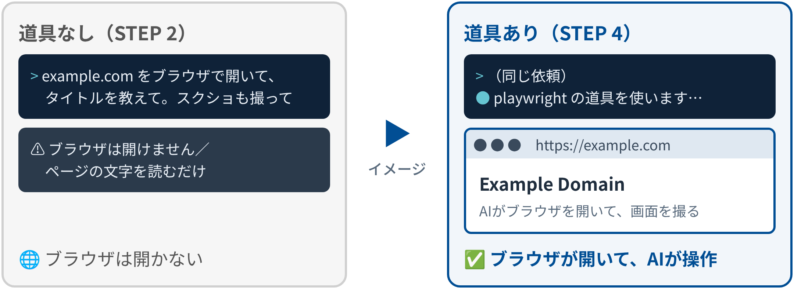

- つなげなかった方も、**講師の画面で違いを見てください**

<!--
覚えて帰る1つ：同じ依頼でも、MCP が無いと「できません」、つなぐとブラウザが開いてAIが操作する。
MCP あり・なしで同じ依頼の結果を並べる（「できません」→ ブラウザが開いて操作）。
救済策：講師の画面で Before / After を見せる。つながらなかったときは、事前に撮っておいた Before / After の結果のスクリーンショット控えを画面共有で見せる。
要確認：企画 Issue では、このスライドに Before / After の結果（Claude Code の返答と、Playwright が開いたブラウザのスクリーンショット）を載せる想定。いまの図はイメージ図（assets/mcp/beforeafter.png。返答の文言は実際とは異なる）。リハーサルで撮影したら実際のスクリーンショットに差し替える（tkb では pair が使えないので、画像だけの段落で置き、はみ出しを PNG で確認する）。
2分。
-->

---

<!-- _class: tkb grid -->
<!-- _header: 'PART 04 · ハンズオン' -->

## 止まっていたら、ここを見てください

- **Node.js が無い・古い**
  - 18 未満・未導入なら **コース B** へ
- **`/mcp` で failed**
  - 初回はダウンロードに時間がかかる。待って再起動
- **追加し間違えた**
  - `claude mcp remove playwright` で消して追加し直す
- **ブラウザが開かない**
  - 用意ができていない。講師画面を見る

<!--
うまく動かないとき：node --version が 18 未満・未インストール（→ コース B へ）／/mcp で failed（初回は npx のダウンロードで時間がかかる。少し待って Claude Code を再起動）／追加し間違えた（claude mcp remove playwright で消して追加し直す。コース B なら claude mcp remove deepwiki）／ブラウザが開かない（Playwright がブラウザを用意できていない。講師画面を見る）。
後片付け：使い終わったら claude mcp remove playwright で外せる、と添える。
3分。
-->

---

<!-- _class: tkb -->
<!-- _header: 'PART 05 · 応用' -->

## 仕事の道具とも、つなげられる

- **Notion・GitHub など**は、claude.ai の**コネクタ画面**から追加
  → Claude Code でも使える
- **スキル ＋ MCP** の組み合わせもできる
  （例：「議事録スキル」の手順の中で **Notion MCP** に保存させる）
- 使い終わった道具は `claude mcp remove 名前` で外せる

<!--
応用：仕事の道具とつなぐ例（Notion・GitHub などは claude.ai のコネクタ画面から追加すれば Claude Code でも使える）。
「議事録スキル」＋「Notion MCP」のように、スキルの手順の中で MCP の道具を使わせることもできる。スキルは「作業の手順」を書いたファイル（必要なときだけ AI が読む手順書）、と一言で説明する。
claude.ai のコネクタは画面の紹介だけにする。
時間が押したら、スコープの説明を『既定のままでよい』の一言にする（この応用スライドは動画パートの分ですでに1分に短縮済み）。
1分（動画パートの分をここで吸収）。
-->

---

<!-- _class: tkb -->
<!-- _header: 'CLOSING' -->

## よく使う道具を、1つAIにつないでみよう

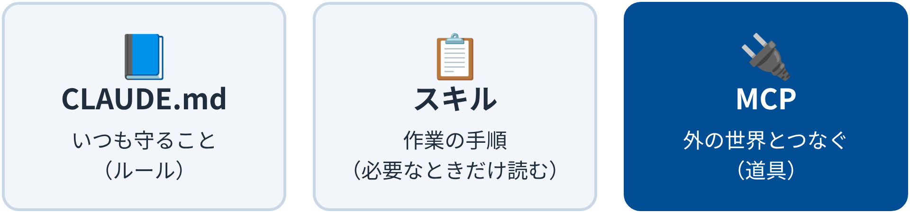

- つなぐのは **コピペ1行**。信頼できるものだけ
- 次の一歩：よく使うサービスに **MCP があるか調べて**、1つつなぐ
- つないだ道具は、**シンラボの Slack** で共有・相談できます
- 今日の動画の続き（設定や注意点）は **Sinlab Study** で

<!--
まとめ：いつも守ることは CLAUDE.md／作業の手順はスキル／外とつなぐのは MCP。つなぐのはコピペ1行、信頼できるものだけ。
次の一歩：自分がよく使うサービスに MCP があるか調べて、1つつないでみる。つないでみた道具はシンラボの Slack で共有・相談できる、とこの後のシンラボ紹介につなげる。
動画パートの導線：今日見た動画（AI駆動開発講座 第8回「MCPの活用」）の続き（設定の方法・/mcp での管理・注意点など）は Sinlab Study で見られる。Sinlab Study は無料で始められ、全コンテンツは月額1,500円（税込）（Sinlab Study サービスサイト https://study.future-tech-association.org/ のトップの記載、2026-11-23 確認）。詳しくはこのあとの Sinlab Study 紹介スライドで（宣伝はここと紹介スライドの1回にまとめる）。
3分。
-->

---

<!-- _class: src -->
<!-- _header: 'APPENDIX · 参考' -->
<!-- _footer: '' -->

## 参考

- **Claude Code の MCP**：追加方法・スコープ・安全上の注意（Anthropic 公式ドキュメント）
  Claude Code Docs <https://code.claude.com/docs/en/mcp>
- **MCP の仕様**：Model Context Protocol 公式サイト
  modelcontextprotocol.io <https://modelcontextprotocol.io/>
- **Playwright MCP**：追加コマンド・Node.js 18 以上（Microsoft）
  GitHub <https://github.com/microsoft/playwright-mcp>
- **DeepWiki MCP**：URL・認証不要（Devin）
  Devin Docs <https://docs.devin.ai/work-with-devin/deepwiki-mcp>

<!--
参考スライド。発表では映すだけで読まない。資料を後で見返す人向け。
-->

---

<!-- _paginate: skip -->
<!-- _footer: '' -->
<!-- _class: tk lg -->

## AI駆動開発体験会アンケート

チャットにもURLを貼りますので、ご回答お願いします<br>（アンケート回答頂いた方には本スライドをお送りします）


<!--
アンケートURL（チャット貼り付け用）：
https://docs.google.com/forms/d/e/1FAIpQLSfJlSsAqvXaS6id-DIRjz9EIsMUYUnYBdpsrXkd1kOEt1i9-Q/viewform?usp=header
回答者に本スライドを送る旨を口頭でも添える。
-->

---

<!-- _paginate: skip -->
<!-- _footer: '' -->
<!-- _class: tk pair -->

## AI駆動開発体験会のご支援のお願い

本AI駆動開発 体験会を継続するため、<br>ご支援をお願いいたします。

- 金額は任意で設定可（500円以上）
- Stripeによる安全な決済
- 決済方法：クレジットカード・Google Pay・Apple Pay
- 入力頂いたメールアドレス宛に領収書を送付

<p class="fig">

決済用リンク
</p>

<!--
決済URL（チャット貼り付け用）：https://buy.stripe.com/6oUbJ1ePw5TMgh0eQe0Fi0c
opening 3枚目とほぼ同内容。導入文だけ「本〜継続するため、」になっている。
-->

---

<!-- _paginate: skip -->
<!-- _footer: '' -->
<!-- _class: tk pair -->

## AI駆動開発体験会のご支援のお願い

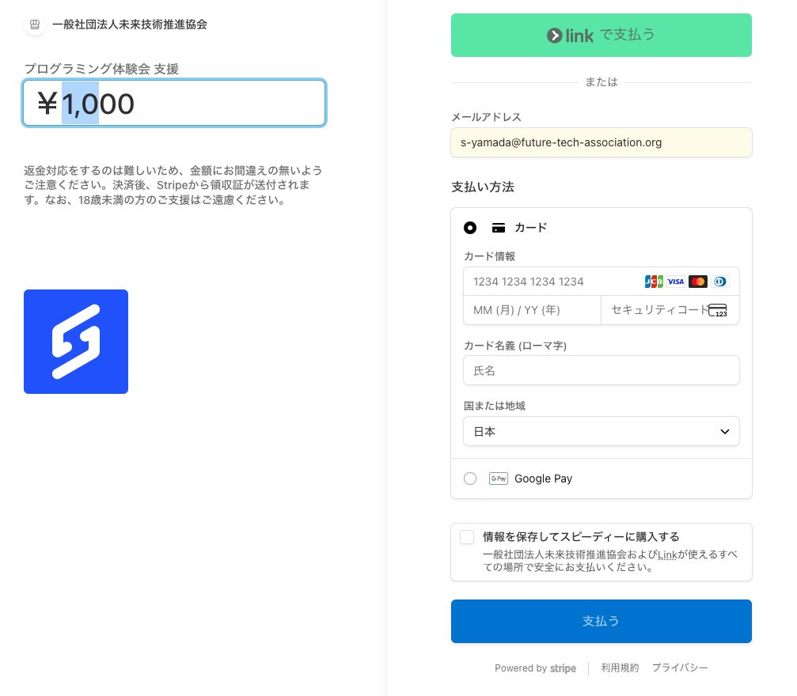

<p class="fig">

決済用リンク
</p>

<!--
決済画面のスクショ（メールアドレスは公開済みのためマスキングしない）＋同じ決済QR。
決済URL：https://buy.stripe.com/6oUbJ1ePw5TMgh0eQe0Fi0c
-->

---

<!-- _paginate: skip -->
<!-- _footer: '' -->
<!-- _class: tk pair lg -->

## 今後のイベントのお知らせ

**Web技術・AI駆動開発体験会**

- 12/14 (月) 20時~ 業務効率化講座 CSVとフォルダの自動化
- 1/18 (月) 20時~ AI駆動開発講座 Hooksの活用
- 1/25 (月) 20時~ Git活用講座

<p class="fig">

申込フォーム
</p>

<!--
差し替え欄：小見出し（シリーズ名）と開催日程。転記時に最新の3〜4件へ更新する。箇条書きの「日付 (曜) 時刻~ 講座名 テーマ」の型は残す。
申込URL（チャット貼り付け用）：https://forms.gle/rq9TDREWNbZwoEAW6
1/25 の Git活用講座は変更の可能性あり（yamada、2026-11-23時点）。
-->

---

<!-- _paginate: skip -->
<!-- _footer: '' -->
<!-- _class: tk msg -->

## シンギュラリティ・ラボとは

テクノロジーによる<br>社会課題解決を目指すコミュニティ


<!--
コミュニティの一言紹介。写真は集合カット（Singularity Lab の看板）。短く置いて次の「どんなコミュニティなの？」へ渡す。
-->

---

<!-- _paginate: skip -->
<!-- _footer: '' -->
<!-- _class: tk pair lg -->

## どんなコミュニティなの？

会員数は約50名で、技術職・文系職・学生等、多くの職種の方が参加

活動目的やペースは各自の自由<br>（アプリ開発、不定期の情報収集など）

オンライン以外に、ワーケーションや飲み会等のオフライン企画あり

<p class="fig">
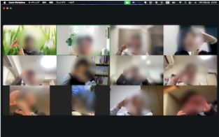
オンライン交流会

お花見の様子
</p>

<!--
多様性・各自のペース・オフライン企画の3点。写真はオンライン交流会とお花見。
-->

---

<!-- _paginate: skip -->
<!-- _footer: '' -->
<!-- _class: tk pair wide -->

## シンラボ活動のご紹介「スキルアップ講座」

月に数回、AI開発スキルや<br>基礎的なWeb技術講座（マークダウン等）<br>を開催。

※アーカイブ動画や講座内で使った<br>記事サイトはいつでも閲覧可能

<p class="fig">
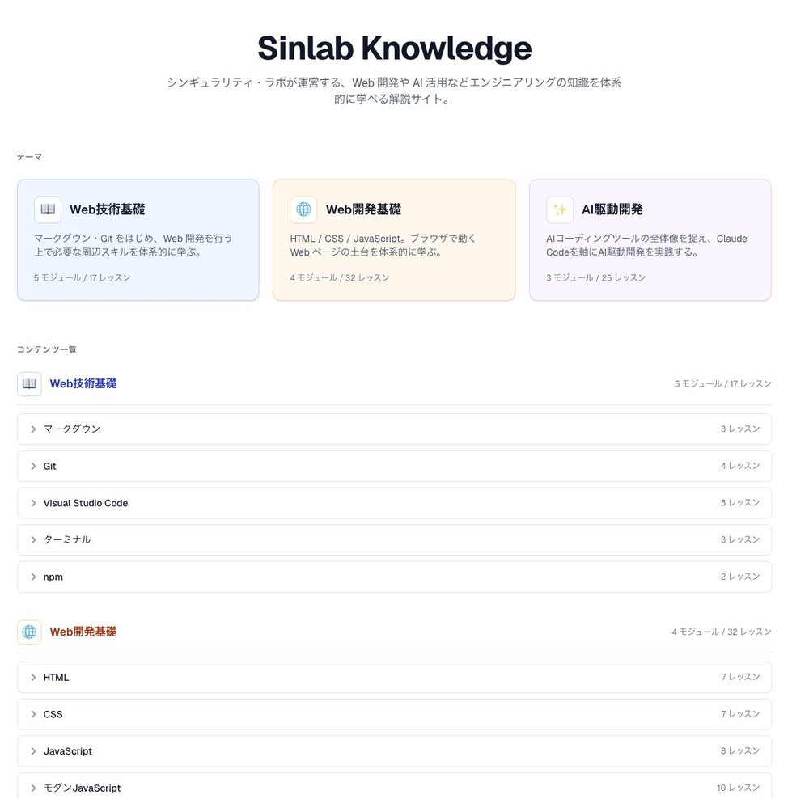
</p>

<!--
講座の頻度と内容、アーカイブ・記事サイトがいつでも見られる点。画像は講座で使っている記事サイト（Sinlab Knowledge）。
-->

---

<!-- _paginate: skip -->
<!-- _footer: '' -->
<!-- _class: tk pair wide -->

## シンラボ活動のご紹介「Sinlab Study」

**自分のペースで学習する** Web学習支援サービス（一部無料公開中）

**主な機能**

- 動画・スライドでの学習
- 課題提出による実践力強化
- 提出課題のAIレビュー

|  |  |
|:---:|:---:|
| サービスサイト | 紹介サイト |

<p class="fig">
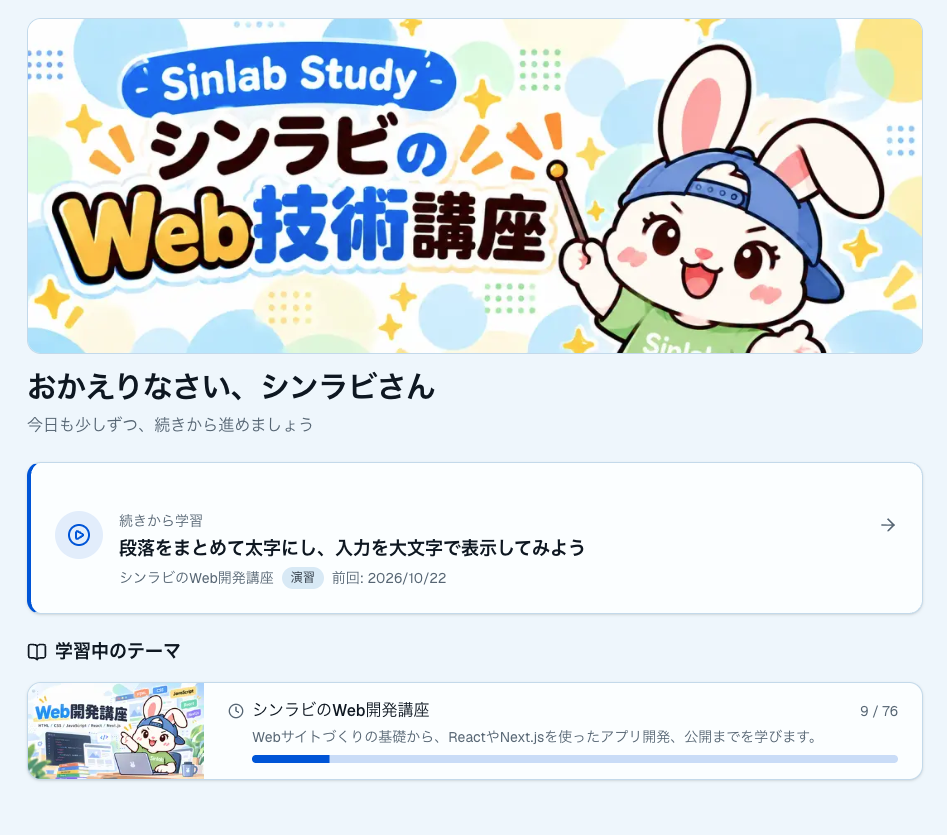
トップ画面
</p>

<!--
サービスサイト：https://study.future-tech-association.org/
紹介サイト：https://sinlab.future-tech-association.org/sinlab-study/
QRの取り違えに注意（左＝サービスサイト / 右＝紹介サイト。元資料の配置）。
-->

---

<!-- _paginate: skip -->
<!-- _footer: '' -->
<!-- _class: tk pair wide -->

## シンラボ活動のご紹介「チーム開発体験」

オンラインで集まって、<br>コミュニティ内で使うアプリを開発

個人では体験できないチーム<br>ならではの開発フローや知見を<br>学べる

見学のみも可

<p class="fig">
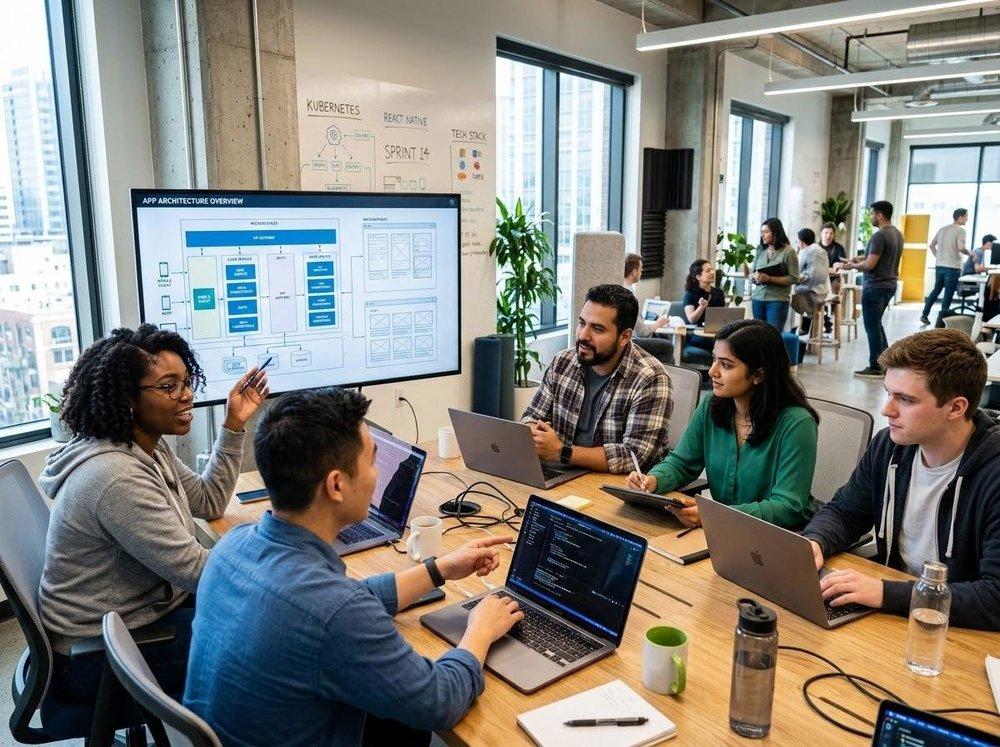
</p>

<!--
オンラインでのチーム開発。個人開発では得にくいフロー・知見が学べること、見学だけでも参加できることを添える。
-->

---

<!-- _paginate: skip -->
<!-- _footer: '' -->
<!-- _class: tk big -->

## 11月の主なシンラボ活動の紹介

- AI駆動開発の解説（AIアシスタントの紹介）
- Web技術解説講座（yaml形式の解説）
- Webアプリのチーム開発
- AIを使ったアプリ開発会
- 全体交流会

<!--
差し替え欄：見出しの月と箇条書きの中身を、転記時に直近月の活動へ更新する。箇条書き4項目の型は残す。
-->

---

<!-- _paginate: skip -->
<!-- _footer: '' -->
<!-- _class: tk big -->

## 会費は？

- 入会費　：無料
- 一般会員：3,000円／月（税込、前払い）
- 学生会員：1,500円／月　※高校生、高専生は無料
- 支払い方法
  - クレジットカード決済のみ
  - 毎月27日に次月分を自動決済

<!--
学生は高校生・高専生が無料である点を口頭で補う。
-->

---

<!-- _paginate: skip -->
<!-- _footer: '' -->
<!-- _class: tk big -->

## 注意すること

- 誹謗中傷や勧誘活動などの、人の嫌がる行為は禁止
- 会員の個人情報の収集や無断での外部への開示は禁止
- 入会時の申告内容に虚偽があったり、会費を2ヶ月滞納した場合は退会となるので注意

<!--
禁止事項は3点だけ。責めずに「これだけ守れば大丈夫」のトーンで読む。
-->

---

<!-- _paginate: skip -->
<!-- _footer: '' -->
<!-- _class: tk pair -->

## フリー会員のご案内

いきなり会員になるのはハードルが高い...<br>という方に向けて“**シンラボ フリー会員**”の募集を開始しました

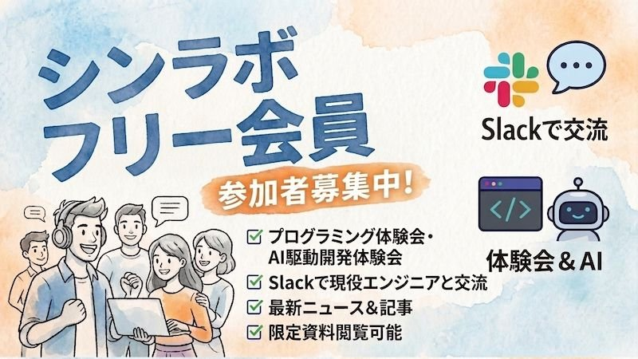

<p class="fig">
申し込みは<br>専用フォームから！

</p>

<!--
有料会員の前段として無料のフリー会員を案内する（Slack交流・体験会・限定資料閲覧）。
申込フォーム：https://docs.google.com/forms/d/e/1FAIpQLSeW5Trd4st5TU_zMzKZeZbFE0t0B6YGxNpJ0veAnhCkhE94eA/viewform
-->

---

<!-- _paginate: skip -->
<!-- _footer: '' -->
<!-- _class: tk msg -->

## 最後に

シンラボの仲間と一緒に、<br>スキルを高めて新しい価値を<br>創り出していきましょう！

<!--
クロージング。余韻を残して終える。
-->

---

<!-- _paginate: skip -->
<!-- _footer: '' -->
<!-- _class: split tk -->

<!--
区切りの空白スライド（右に青グラデのパネルだけ）。前回資料どおり「最後に」と付録の間に置く。
-->

---

<!-- _paginate: skip -->
<!-- _footer: '' -->
<!-- _class: tk pair wide -->

## シンラボ活動のご紹介「Sinlab Knowledge」

Web技術の重要な知識をまとめたサイト（会員のみアクセス可）

**主な内容**

- マークダウン・Git操作
- HTML/CSS/JavaScriptの基礎
- React等のWeb開発言語の基礎
- AI駆動開発のノウハウ

|  |
|:---:|
| サービスサイト |

<p class="fig">

https://knowledge.future-tech-association.org/
</p>

<!--
付録。質問が出たとき・時間が余ったときに見せる会員限定の学習サイト。
URL：https://knowledge.future-tech-association.org/
-->
