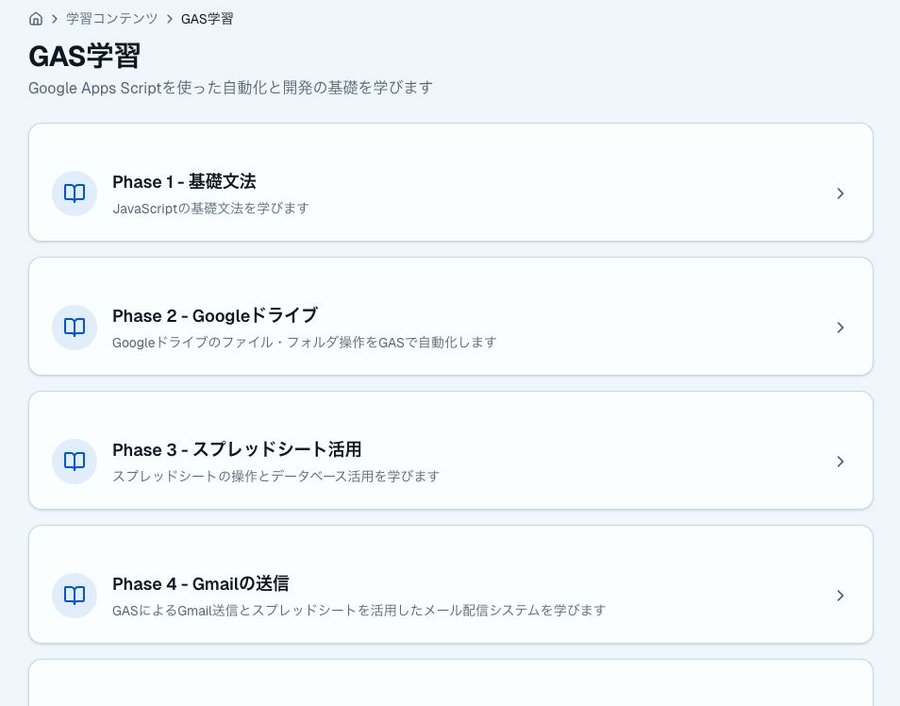

<!--
【転記ガイド（このコメントブロック自体は転記対象外。転記対象は最初の `_paginate: skip` 行から EOF まで）】
- 企画 Issue に `体験会` ラベルが付いたデッキでは、下の `_paginate: skip` 行から始まる内容を、
  デッキの最後（APPENDIX・参考スライドも含めた全スライドの後）に、順序どおり・文言を改変せずに転記する
  （省略・並べ替え禁止）。front matter とこの案内コメント自体は転記しない。
- 転記の最初（直前の既存スライドとの間）に `---` を入れ、既存の最終スライドと合体しないようにする。
- 各スライド先頭のディレクティブ（_paginate: skip と _footer: ''）も一緒に、スライドごとに転記する
  （_paginate / _footer はそのスライド1枚にしか効かないスポットディレクティブなので、複数枚に差し替えたときは
  各スライドの先頭に書く。デッキ側の `paginate: true` とタイトル入り `footer:` がそのまま乗ってしまうのを防ぐため、
  抑止しない設計にするなら、その旨を CLAUDE.md に明記してから外すこと）。
- 画像パス `../assets/taikenkai/` は `templates/` からも `decks/` からも同じ相対位置なので、転記時に書き換えない。
- この front matter はこのファイル単体をプレビューするためのもの。デッキへは転記しない。
- 冒頭用の定型スライドは `templates/taikenkai-opening.md`（別ファイル）。
- 並びは前回の体験会資料どおり：アンケート → ご支援 → 今後のイベント → シンラボ紹介 → 会費・注意 → フリー会員 → 最後に →
  空白の青スライド（区切り）→ 付録「Sinlab Knowledge」。付録もこのファイルに含めて最後に置く。
- 各スライドの `_class` に付いている `tk` は、前回の体験会資料（Google スライド）の見た目に寄せる体験会専用クラス。外さない。
- 差し替え欄（転記時に改変してよい唯一の箇所。見出し・箇条書きの型は残す）：
  1. 「今後のイベントのお知らせ」の小見出し（シリーズ名）と開催日程（件数は3〜4件が目安）
  2. 「○月の主なシンラボ活動の紹介」の見出し月と箇条書きの中身
  3. アンケート・ご支援スライドの見出しと導入文にある体験会名「AI駆動開発」（例：「Web技術」。opening と同じ名前にそろえる。
     値は企画 Issue「基本情報」表の「体験会名」欄に書き、`taikenkai_slides.py wrap` がそこから読み取って一括で入れる）
  それ以外の文言・画像・順序は改変禁止。QR・写真を差し替えるときは `assets/taikenkai/` のファイルを置き換える。
-->

<!-- _paginate: skip -->
<!-- _footer: '' -->
<!-- _class: tk -->

## AI駆動開発体験会アンケート

チャットにもURLを貼りますので、ご回答お願いします （アンケート回答頂いた方には本スライドをお送りします）

<!--
アンケートURL（チャット貼り付け用）：
https://docs.google.com/forms/d/e/1FAIpQLSfJlSsAqvXaS6id-DIRjz9EIsMUYUnYBdpsrXkd1kOEt1i9-Q/viewform?usp=header
回答者に本スライドを送る旨を口頭でも添える。
-->

---

<!-- _paginate: skip -->
<!-- _footer: '' -->
<!-- _class: tk pair -->

## AI駆動開発体験会のご支援のお願い

本AI駆動開発 体験会を継続するため、 ご支援をお願いいたします。

- 金額は任意で設定可（500円以上）
- Stripeによる安全な決済
- 決済方法：クレジットカード・Google Pay・Apple Pay
- 入力頂いたメールアドレス宛に領収書を送付

決済用リンク

<!--
決済URL（チャット貼り付け用）：https://buy.stripe.com/6oUbJ1ePw5TMgh0eQe0Fi0c
opening 3枚目とほぼ同内容。導入文だけ「本〜継続するため、」になっている。
-->

---

<!-- _paginate: skip -->
<!-- _footer: '' -->
<!-- _class: tk pair -->

## AI駆動開発体験会のご支援のお願い

決済用リンク

<!--
決済画面のスクショ（メールアドレスは公開済みのためマスキングしない）＋同じ決済QR。
決済URL：https://buy.stripe.com/6oUbJ1ePw5TMgh0eQe0Fi0c
-->

---

<!-- _paginate: skip -->
<!-- _footer: '' -->
<!-- _class: tk pair -->

## 今後のイベントのお知らせ

**Web技術・AI駆動開発体験会**

- 10/19 (月) 20時~ 業務効率化講座 Pythonによる自動化
- 11/2 (月) 20時~ AI駆動開発講座 Skillsの利用
- 11/9 (月) 20時~ 業務効率化講座 Excel集計
- 11/16 (月) 20時~ チーム開発体験会

申込フォーム

<!--
差し替え欄：小見出し（シリーズ名）と開催日程。転記時に最新の3〜4件へ更新する。箇条書きの「日付 (曜) 時刻~ 講座名 テーマ」の型は残す。
申込URL（チャット貼り付け用）：https://forms.gle/rq9TDREWNbZwoEAW6
-->

---

<!-- _paginate: skip -->
<!-- _footer: '' -->
<!-- _class: tk msg -->

## シンギュラリティ・ラボとは

テクノロジーによる 社会課題解決を目指すコミュニティ

<!--
コミュニティの一言紹介。写真は集合カット（Singularity Lab の看板）。短く置いて次の「どんなコミュニティなの？」へ渡す。
-->

---

<!-- _paginate: skip -->
<!-- _footer: '' -->
<!-- _class: tk pair -->

## どんなコミュニティなの？

会員数は約50名で、技術職・文系職・学生等、多くの職種の方が参加

活動目的やペースは各自の自由 （アプリ開発、不定期の情報収集など）

オンライン以外に、ワーケーションや飲み会等のオフライン企画あり

オンライン交流会

お花見の様子

<!--
多様性・各自のペース・オフライン企画の3点。写真はオンライン交流会とお花見。
-->

---

<!-- _paginate: skip -->
<!-- _footer: '' -->
<!-- _class: tk pair wide -->

## シンラボ活動のご紹介「スキルアップ講座」

月に数回、AI開発スキルや 基礎的なWeb技術講座（マークダウン等） を開催。

※アーカイブ動画や講座内で使った 記事サイトはいつでも閲覧可能

<!--
講座の頻度と内容、アーカイブ・記事サイトがいつでも見られる点。画像は講座で使っている記事サイト（Sinlab Knowledge）。
-->

---

<!-- _paginate: skip -->
<!-- _footer: '' -->
<!-- _class: tk pair wide -->

## シンラボ活動のご紹介「Sinlab Study」

**自分のペースで学習する** Web学習支援サービス（一部無料公開中）

**主な機能**

- 動画・スライドでの学習
- 課題提出による実践力強化
- 提出課題のAIレビュー

|  |  |
|:---:|:---:|
| サービスサイト | 紹介サイト |

フェーズ別画面

<!--
サービスサイト：https://study.future-tech-association.org/
紹介サイト：https://sinlab.future-tech-association.org/sinlab-study/
QRの取り違えに注意（左＝サービスサイト / 右＝紹介サイト。元資料の配置）。
-->

---

<!-- _paginate: skip -->
<!-- _footer: '' -->
<!-- _class: tk pair wide -->

## シンラボ活動のご紹介「チーム開発体験」

オンラインで集まって、 コミュニティ内で使うアプリを開発

個人では体験できないチーム ならではの開発フローや知見を 学べる

見学のみも可

<!--
オンラインでのチーム開発。個人開発では得にくいフロー・知見が学べること、見学だけでも参加できることを添える。
-->

---

<!-- _paginate: skip -->
<!-- _footer: '' -->
<!-- _class: tk -->

## 9月の主なシンラボ活動の紹介

- AI駆動開発の解説（AIを使ったGAS開発方法）
- Web技術の解説講座（DevToolsの解説）
- Webアプリのチーム開発
- もくもく会

<!--
差し替え欄：見出しの月と箇条書きの中身を、転記時に直近月の活動へ更新する。箇条書き4項目の型は残す。
-->

---

<!-- _paginate: skip -->
<!-- _footer: '' -->
<!-- _class: tk -->

## 会費は？

- 入会費　：無料
- 一般会員：3,000円／月（税込、前払い）
- 学生会員：1,500円／月　※高校生、高専生は無料
- 支払い方法
  - クレジットカード決済のみ
  - 毎月27日に次月分を自動決済

<!--
学生は高校生・高専生が無料である点を口頭で補う。
-->

---

<!-- _paginate: skip -->
<!-- _footer: '' -->
<!-- _class: tk -->

## 注意すること

- 誹謗中傷や勧誘活動などの、人の嫌がる行為は禁止
- 会員の個人情報の収集や無断での外部への開示は禁止
- 入会時の申告内容に虚偽があったり、会費を2ヶ月滞納した場合は退会となるので注意

<!--
禁止事項は3点だけ。責めずに「これだけ守れば大丈夫」のトーンで読む。
-->

---

<!-- _paginate: skip -->
<!-- _footer: '' -->
<!-- _class: tk pair -->

## フリー会員のご案内

いきなり会員になるのはハードルが高い... という方に向けて“**シンラボ フリー会員**”の募集を開始しました

申し込みは 専用フォームから！

<!--
有料会員の前段として無料のフリー会員を案内する（Slack交流・体験会・限定資料閲覧）。
申込フォーム：https://docs.google.com/forms/d/e/1FAIpQLSeW5Trd4st5TU_zMzKZeZbFE0t0B6YGxNpJ0veAnhCkhE94eA/viewform
-->

---

<!-- _paginate: skip -->
<!-- _footer: '' -->
<!-- _class: tk msg -->

## 最後に

シンラボの仲間と一緒に、 スキルを高めて新しい価値を 創り出していきましょう！

<!--
クロージング。余韻を残して終える。
-->

---

<!-- _paginate: skip -->
<!-- _footer: '' -->
<!-- _class: split -->

<!--
区切りの空白スライド（右に青グラデのパネルだけ）。前回資料どおり「最後に」と付録の間に置く。
-->

---

<!-- _paginate: skip -->
<!-- _footer: '' -->
<!-- _class: tk pair wide -->

## シンラボ活動のご紹介「Sinlab Knowledge」

Web技術の重要な知識をまとめたサイト（会員のみアクセス可）

**主な内容**

- マークダウン・Git操作
- HTML/CSS/JavaScriptの基礎
- React等のWeb開発言語の基礎
- AI駆動開発のノウハウ

|  |
|:---:|
| サービスサイト |

https://knowledge.future-tech-association.org/

<!--
付録。質問が出たとき・時間が余ったときに見せる会員限定の学習サイト。
URL：https://knowledge.future-tech-association.org/
-->
